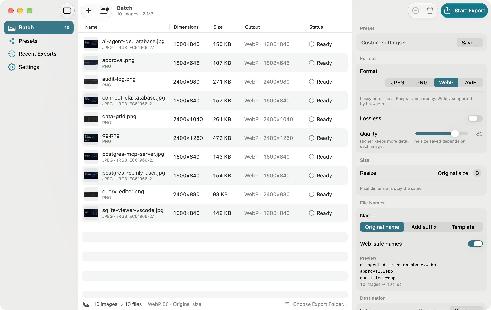

<div align="center">


# Pixtamer

**Turn a folder of images into web-ready files, on your Mac.**

Convert, compress, resize and rename whole batches into JPEG, PNG, WebP and AVIF.<br>
Native SwiftUI. No account, no upload, no network access.

[](https://apps.apple.com/app/pixtamer/id6831520622)

[](https://github.com/heysidhant/pixtamer/stargazers)
[](LICENSE)
[](https://github.com/jaywcjlove/awesome-mac)


[Website](https://pixtamer.pages.dev) · [Mac App Store](https://apps.apple.com/app/pixtamer/id6831520622) · [Report a bug](https://github.com/heysidhant/pixtamer/issues)



</div>

## What it does

A real export: **10 images, 78.7 MB in, 30 web files, 927 KB out.**

- **Convert** to JPEG, PNG, WebP (bundled libwebp) or AVIF.
- **Compress** with a quality setting, and see the real before-and-after size of every file.
- **Resize** to every width your `srcset` needs, in one pass. Small images are never upscaled.
- **Rename** to clean, web-safe file names like `img_4821-1440w.webp`.
- **Presets** save a recipe once and reuse it.
- **Safe on real work.** Originals are never edited, nothing is overwritten unless you say so, and one bad file won't stop the batch.
- **Private.** Sandboxed, with no network access. Nothing leaves your Mac.

If Pixtamer saves you time, a ⭐ helps other people find it.

## Install

**[Mac App Store](https://apps.apple.com/app/pixtamer/id6831520622)**: free, with automatic updates.

**Homebrew** ([tap](https://github.com/heysidhant/homebrew-tap)):

```sh
brew tap heysidhant/tap
brew trust heysidhant/tap
brew install --cask pixtamer
```

**DMG**: download the latest `Pixtamer-<version>.dmg` from [Releases](https://github.com/heysidhant/pixtamer/releases),
open it and drag Pixtamer to Applications. Builds are signed with a Developer ID and notarized by Apple.

<details>
<summary>Listed on</summary>
<br>

<a href="https://www.opensourcealternatives.to"></a>
<a href="https://macbase.app/apps/pixtamer?ref=badge"></a>
<a href="https://macpip.com/apps/pixtamer"></a>

</details>

## Requirements

- macOS 14 or later to run (formats are detected at runtime; see below).
- Xcode 16 or later to build (developed and verified with Xcode 27.0, Swift 6.4, on macOS 27).

## Build and run

```sh
open Pixtamer.xcodeproj          # then Run the "Pixtamer" scheme
```

or from the command line:

```sh
xcodebuild -project Pixtamer.xcodeproj -scheme Pixtamer -configuration Debug \
  -destination 'platform=macOS' -derivedDataPath build/DerivedData build
open build/DerivedData/Build/Products/Debug/Pixtamer.app
```

Debug builds are signed "to run locally" (ad hoc) with the App Sandbox enabled, so no Apple developer
account is needed to build and run.

## Package a DMG

```sh
scripts/make-dmg.sh                              # → dist/Pixtamer-<version>.dmg (universal arm64 + x86_64)
NOTARY_PROFILE=<profile> scripts/make-dmg.sh     # also notarize and staple
```

With a "Developer ID Application" certificate in your keychain, the script signs the app and DMG with it,
and notarizes when `NOTARY_PROFILE` names a profile saved with `xcrun notarytool store-credentials`.
Without one, the build is ad-hoc signed: it opens normally on the Mac that built it, and other Macs must
allow it once in System Settings → Privacy & Security → Open Anyway.

## Package for the Mac App Store

```sh
scripts/make-appstore.sh              # → dist/AppStore/Pixtamer.pkg, signed for the Mac App Store
UPLOAD=1 scripts/make-appstore.sh     # also uploads to App Store Connect
```

This needs the maintainer's Apple Developer account in Xcode. The listing, privacy answers and review notes are in
[docs/APP_STORE.md](docs/APP_STORE.md).

## Test

All processing logic lives in the `PixtamerKit` Swift package and is tested without the UI:

```sh
swift test --package-path Packages/PixtamerKit
# or, with Xcode's test runner:
cd Packages/PixtamerKit && xcodebuild -scheme PixtamerKit -destination 'platform=macOS' test
```

97 tests cover file naming and sanitisation, resize maths and no-upscale, responsive variant counts,
collision policies and source protection, preset persistence and migration, export accounting, real
JPEG/PNG/WebP/AVIF output (transparency, orientation, metadata, colour profiles), failure isolation and
retry, and safe cancellation. Fixtures are generated on the fly.

## Supported formats

| Output | How | Notes |
|---|---|---|
| JPEG | Apple Image I/O | Transparency flattened onto white |
| PNG | Apple Image I/O | Lossless |
| WebP | Bundled libwebp 1.6.0 | Lossy or lossless; metadata removed; converted to sRGB |
| AVIF | Apple Image I/O | Shown only if this Mac's encoder passes a launch-time test |

Inputs: JPEG, PNG, HEIC/HEIF, WebP, AVIF, TIFF, GIF (first frame), BMP, JPEG XL — whatever of these the
running macOS can read. Details and test results: [docs/FORMAT_SUPPORT.md](docs/FORMAT_SUPPORT.md).

## Current limitations

- WebP output carries no metadata or colour profile.
- AVIF availability depends on the macOS version (verified on macOS 27 only).
- 16-bit/HDR sources are exported as 8-bit; animated GIFs export their first frame; RAW/PSD are not accepted.
- PNG output is lossless only (no palette reduction), so photos as PNG are often larger.
- Not yet verified on macOS 14/15, with VoiceOver, or with very large batches under Instruments.

See [docs/IMPLEMENTATION_PLAN.md](docs/IMPLEMENTATION_PLAN.md) for the open checklist.

## Project layout

```
App/                      SwiftUI/AppKit app (screens, view models)
Packages/PixtamerKit/     Domain, import, image processing, export, persistence + tests
Config/                   Entitlements
docs/                     Requirements, UI spec, flows, architecture, plan, format support, audit
```

Architecture: [docs/ARCHITECTURE.md](docs/ARCHITECTURE.md).

## Contributing

Bug reports, ideas and pull requests are welcome.

- Look for issues labelled [`good first issue`](https://github.com/heysidhant/pixtamer/labels/good%20first%20issue) or [`help wanted`](https://github.com/heysidhant/pixtamer/labels/help%20wanted).
- The [current limitations](#current-limitations) are a good place to start, especially testing on macOS 14 and 15 and with VoiceOver.
- Processing logic lives in `PixtamerKit`. Add a test for any change there and run `swift test --package-path Packages/PixtamerKit` before opening a PR.
- For a bigger change, open an issue first so we can agree on the approach.

## Reporting a bug

Open an [issue](https://github.com/heysidhant/pixtamer/issues). In the app choose **Help → Pixtamer Help → Copy Diagnostics** and paste the text into your report with
the steps to reproduce. Diagnostics list versions, format support and error codes; they contain no images
and no full file paths. Do not attach private images unless you are happy to share them.

## Privacy

Pixtamer collects nothing. See the [privacy policy](PRIVACY.md).

## Third-party code

libwebp 1.6.0 (BSD-3-Clause, with the WebM project patent grant), vendored unmodified in
`Packages/PixtamerKit/Sources/CWebP/libwebp` — see `VENDORED.md`, `COPYING` and `PATENTS` there.

## Licence

[MIT](LICENSE) © 2026 Sidhant Sinha.

## More from the maker

[App Vanish](https://github.com/heysidhant/appvanish) is a free, open-source Mac uninstaller: drop an app on the bin and remove the files it left behind.


Need video, audio, PDF and on-device AI tools as well as images? [MightyBench](https://mightybench.com/?ref=pixtamer)
puts 49 private tools in one native Mac app.
